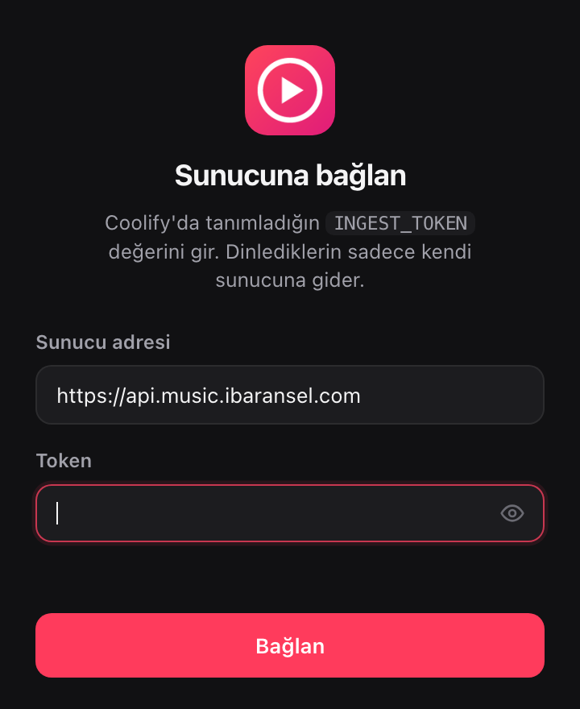
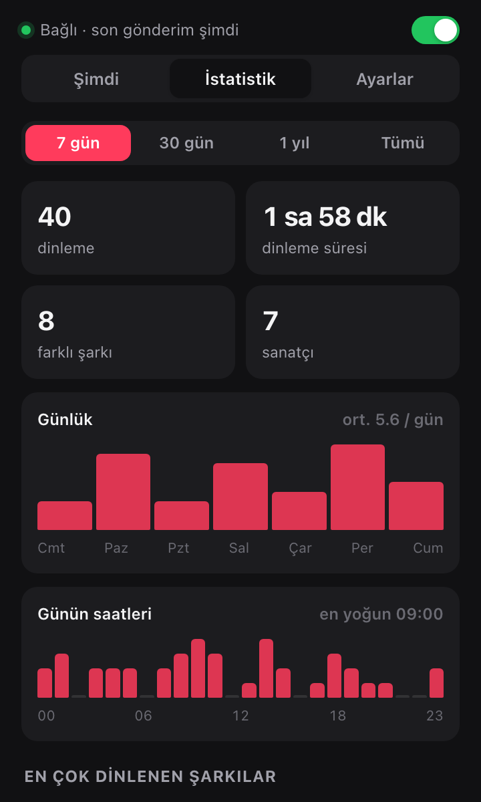

# YT Music Now Playing

YouTube Music'te (Chrome eklentisi) ve Mac'te Apple Music'te (menü çubuğu uygulaması) dinlediğin şarkıyı kendi sunucuna gönderen küçük bir sistem. Kendi sitende canlı "şu an dinliyorum" kartı gösterebilir, GitHub profiline kart ekleyebilir ve dinleme istatistiklerini takip edebilirsin.

Tek kullanıcı için tasarlandı: hesap ya da şifre yok, sunucuda tanımladığın bir token yeterli.

<p align="center">
  
  
</p>

---

## Nasıl çalışıyor

```
YT Music sekmesi ──► content.js ──► background.js ──┐
                    (video event'leri)  (token, kuyruk) ├─► API (Express) ──► PostgreSQL
Mac'te Music ──► Now Playing.app ───────────────────┘          │
                (playerInfo bildirimi + konum)                  ├─► /api/now-playing/stream (SSE) ──► popup, sitendeki widget
                                                                └─► /api/stats, /api/card.svg
```

- **Eklenti**, sürekli polling yapmak yerine `<video>` elementinin event'lerini dinler. Sunucuya yalnızca şarkı değişince, play/pause/seek olunca ve çalarken 15 sn'de bir heartbeat olarak istek atar. Eski sürüm saniyede 2 istek atıyordu.
- **Dinleme** Last.fm kuralıyla sayılır: şarkının yarısı ya da 4 dakikası gerçekten çalınmış olmalı. Atlanan şarkılar istatistikleri şişirmez. Tekrar (repeat) modunda her tur ayrı bir dinleme sayılır.
- Sunucuya ulaşılamazsa dinlemeler eklentide kuyruğa alınır ve sunucu geri gelince gönderilir. Aynı kayıt iki kez yazılmaz.
- **Mac uygulaması** Music'in `com.apple.Music.playerInfo` bildirimini dinler (şarkı değişimi ve play/pause anında gelir), çalarken konumu saniyede bir yerelden okur. Sunucuya giden trafik eklentiyle aynı: değişiklikte + 15 sn'de bir.
- **İki kaynak birden** açıksa birbirini ezmez: biri çalarken diğerinin duraklaması ya da heartbeat'i durumu değiştirmez, ancak yeni başlayan (ya da şarkı değiştiren) kaynak öne geçer.
- **Canlı durum** sunucunun belleğinde tutulur ve SSE ile anında yayınlanır. Veritabanına sadece anlamlı değişikliklerde yazılır. 45 sn heartbeat gelmezse çalma durmuş sayılır.

## Kurulum

Coolify'a deploy ve eklentiyi yükleme adımları için: **[DEPLOY.md](DEPLOY.md)**

Yerelde çalıştırmak için:

```bash
cd server && cp .env.example .env   # DATABASE_URL ve INGEST_TOKEN'ı doldur
npm install && npm run dev
```

## Mac uygulaması (Apple Music)

Menü çubuğunda duran küçük bir uygulama; Dock'ta görünmez. macOS 14+ ve Xcode (ya da Command Line Tools) gerekir, ücretli Developer hesabı gerekmez.

```bash
cd mac-app && ./build.sh --install
```

1. Menü çubuğundaki ♪ ikonuna tıkla, sunucu adresini ve `INGEST_TOKEN`'ı girip **Bağlan**.
2. Music'te bir şarkı aç. macOS bir kez *"Now Playing, Music'i denetlemek istiyor"* diye sorar → **İzin Ver**. (Reddedersen uygulama yine çalışır ama ileri/geri sarmaları göremez, konumu tahmin eder. Sonradan Sistem Ayarları → Gizlilik ve Güvenlik → Otomasyon'dan açabilirsin.)
3. Ayarlar'dan **Girişte otomatik başlat**'ı aç.

Kapak resmi ve Apple Music linki iTunes Search API'den bulunur. Uygulama yerel imzayla derlendiği için her yeniden derlemede macOS Music erişimini ve Anahtar Zinciri iznini tekrar sorabilir.

Geliştirirken: `swift test` (oturum/dinleme mantığı testleri). Yerel sunucuya Anahtar Zinciri'ne dokunmadan bağlanmak için:

```bash
NOWPLAYING_SERVER=http://localhost:3000 NOWPLAYING_TOKEN=... "build/Now Playing.app/Contents/MacOS/NowPlayingBar"
```

## Sitende göster

### Canlı widget

Kendini otomatik güncelleyen bir kart. Shadow DOM içinde render edildiği için sitenin CSS'iyle çakışmaz.

```html
<div data-ytm-now-playing></div>
<script src="https://api.music.ibaransel.com/widget.js" defer></script>
```

Temayı zorlamak için `data-theme="light"` ya da `data-theme="dark"` ekleyebilirsin.

### GitHub README kartı

```md

```

Açık tema için sonuna `?theme=light` ekle.

### Kendi kodunla

```js
const API = 'https://api.music.ibaransel.com';

// Anlık değişiklikleri dinle
const es = new EventSource(`${API}/api/now-playing/stream`);
es.addEventListener('state', (e) => {
  const { track, isPlaying, position } = JSON.parse(e.data);
  if (track) console.log(`${isPlaying ? '▶' : '⏸'} ${track.title} — ${track.artist}`);
});
```

## API

| Endpoint | Açıklama |
|----------|----------|
| `GET /api/now-playing` | Anlık durum (JSON) |
| `GET /api/now-playing/stream` | Anlık durum, Server-Sent Events (`event: state`) |
| `GET /api/stats?range=7d\|30d\|365d\|all` | İstatistikler, 5 dk cache'li |
| `GET /api/card.svg?theme=dark\|light` | SVG kart |
| `GET /api/preview/deezer/:id` | Deezer önizlemesinin o anki geçerli linkine yönlendirir (302) |
| `POST /api/now-playing` 🔒 | Eklenti / Mac uygulaması → anlık durum |
| `POST /api/scrobble` 🔒 | Eklenti / Mac uygulaması → tamamlanan dinleme |
| `GET /api/auth/check` 🔒 | Token doğrulama |

🔒 olan endpoint'ler `Authorization: Bearer <INGEST_TOKEN>` header'ı ister. Diğerleri herkese açıktır ve dakikada 120 istekle sınırlıdır.

`/api/now-playing` cevabı:

```json
{
  "track": {
    "videoId": "4NRXx6U8ABQ",
    "title": "Blinding Lights",
    "artist": "The Weeknd",
    "album": "After Hours",
    "artwork": "https://lh3.googleusercontent.com/...=w544-h544-l90-rj",
    "duration": 200,
    "url": "https://music.youtube.com/watch?v=4NRXx6U8ABQ",
    "source": "ytmusic"
  },
  "source": "ytmusic",
  "isPlaying": true,
  "position": 42.3,
  "updatedAt": "2026-10-23T15:20:14.824Z",
  "listens": 57,
  "preview": { "url": "https://audio-ssl.itunes.apple.com/...m4a", "source": "apple" }
}
```

`source` şarkının nereden geldiğidir: `ytmusic` (eklenti) ya da `apple-music` (Mac uygulaması). Apple Music şarkılarında `videoId` `null`'dır, `url` `music.apple.com` linkidir; link için her zaman `url`'yi kullan.

`position`, `updatedAt` anındaki konumdur. Çalarken güncel konum `position + (şimdi - updatedAt)` ile hesaplanabilir. Widget bunu kendisi yapar.

`preview`, çalan şarkının 30 sn'lik önizlemesidir ya da `null`. Şarkı değişince önce Apple Music'te (iTunes Search), bulunamazsa Deezer'da aranır; ad, sanatçı ve süre eşleşmezse `null` kalır. Arama arka planda yapılır: yeni şarkı önce `preview: null` ile yayınlanır, önizleme bulununca tekrar yayınlanır. Deezer linkleri ~15 dk'da sona erdiği için Deezer'da `url`, API'ye göre göreli bir yönlendirme yoludur (`/api/preview/deezer/:id`); kullanırken API adresiyle birleştir (`new URL(preview.url, API)`).

### Ziyaret bildirimi

`POST /api/visit` (herkese açık, `text/plain` JSON gövde) siteye giriş ve çıkışı [ntfy](https://ntfy.sh) ile telefona bildirir. `NTFY_TOPIC` boşsa uç hiçbir şey yapmaz. Cevap her durumda `204`'tür.

| `type` | Alanlar | Etki |
|---|---|---|
| `enter` | `sid, path, referrer, timezone, language, device` | "New visitor" bildirimi |
| `view` | `sid, path` | bildirim yok; bekleyen çıkışı iptal eder |
| `return` | `sid` | bildirim yok; bekleyen çıkışı iptal eder |
| `leave` | `sid, path, seconds` | 15 sn beklenir, kimse geri dönmezse "Visitor left" |

Güvenlik: yalnızca `SITE_URL` (ve `www`) Origin'inden gelen istekler işlenir; her alan dar bir desene uymak zorundadır (serbest metin ya da link bildirime giremez); bildirimler IP başına dakikada 5, genelde saatte 60 ve günde 300 ile sınırlıdır (aşılırsa saatte en fazla bir "kısıtlandı" uyarısı gelir); bellekteki tüm sayaçlar sınırlıdır. IP ya da kimlik saklanmaz.

`/api/stats` cevabı: `totals` (dinleme, saniye, farklı şarkı/sanatçı), `topTracks`, `topArtists`, `byHour` (24 saatlik dağılım), `timeline` (günlük ya da aylık) ve `recent` (son 20 dinleme). `topTracks` ve `recent` kayıtlarında da `url` ve `source` alanları var.

## Yapı

| Klasör | İçerik |
|--------|--------|
| `extension/` | Chrome eklentisi (Manifest V3, build adımı yok) |
| `mac-app/` | Apple Music için menü çubuğu uygulaması (Swift, SwiftUI) |
| `server/` | Node 22 + Express 5 + `postgres` + `zod`, Dockerfile |
| `server/public/` | `widget.js` ve demo sayfası |

## Lisans

MIT
